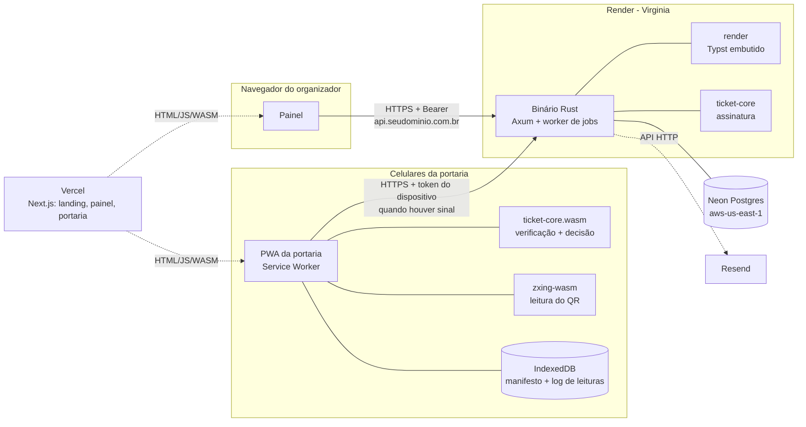
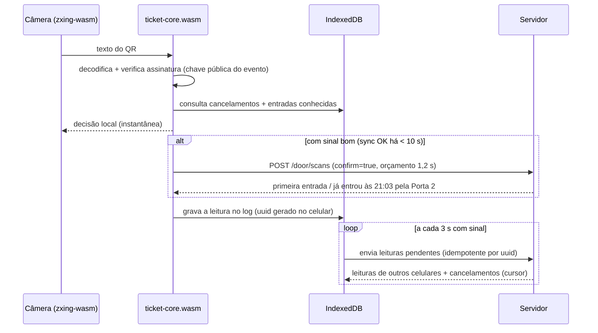

# Arquitetura proposta: Ingresso Impresso

> **Status: aprovada em 2026-10-08**, com as decisões do mantenedor: Next.js na Vercel com pnpm,
> API no Render, Postgres no Neon, e-mail pelo Resend, MVP sem cobrança, impressão em casa e em
> gráfica. Cada decisão relevante tem um ADR em [`docs/adr/`](adr/README.md) com as alternativas
> consideradas.

## 1. Resumo em uma tela

| Tema | Decisão proposta | ADR |
|---|---|---|
| Repositório | Monorepo: Cargo workspace + pnpm workspaces, `just` como ponto de entrada único (sem Turborepo) | [0001](adr/0001-monorepo.md) |
| Núcleo do ingresso | Crate Rust puro `ticket-core` (sem IO), compilado para WASM e usado pelo servidor e pela portaria | [0002](adr/0002-nucleo-rust-wasm.md) |
| Formato do QR | Binário fixo de 74 bytes → base45 (111 caracteres) → QR alfanumérico versão 5, ECC M | [0003](adr/0003-formato-qr-v1.md) |
| Assinatura | Ed25519, um par de chaves por evento (com `key_id` para rotação); o celular guarda só a chave pública | [0004](adr/0004-assinatura-ed25519.md) |
| Custódia das chaves | Chave privada gerada no servidor e cifrada com XChaCha20-Poly1305 sob uma chave mestra fora do banco | [0005](adr/0005-custodia-chaves.md) |
| Portaria offline | Decisão sempre local e instantânea; log de leituras só-de-acréscimo sincronizado; confirmação online com orçamento de tempo quando há sinal | [0006](adr/0006-portaria-offline-sync.md) |
| Acesso da portaria | Link com token no fragmento (`#`) → registro do celular como dispositivo revogável | [0007](adr/0007-acesso-portaria.md) |
| Arquivos | Typst embutido; dados do usuário entram só como dados (nunca como código Typst); arquivos determinísticos regerados sob demanda, sem armazenamento | [0008](adr/0008-geracao-arquivos-typst.md) |
| Frontend | Next.js na Vercel, sem regra de negócio; fala direto com a API em `api.` do domínio (CORS + token Bearer); deploy pré-compilado pelo GitHub Actions | [0009](adr/0009-frontend-nextjs-vercel.md), [0016](adr/0016-sessao-bearer.md) |
| Leitura de QR | `zxing-wasm` em todos os navegadores (o `BarcodeDetector` não existe no Safari do iPhone) | [0010](adr/0010-leitura-qr-navegador.md) |
| Modelo de dados | Faixas `int4range` com restrições de exclusão; sem tabela com uma linha por ingresso | [0011](adr/0011-modelo-dados-faixas.md) |
| Login do organizador | Código de 6 dígitos por e-mail (sem senha), enviado pelo Resend, ou "Entrar com Google" (ID token verificado na API); e-mails em HTML com cota diária e limite por IP; verificação anti-robô (Cloudflare Turnstile) antes de enviar o código; verificação em duas etapas opcional com app autenticador | [0012](adr/0012-autenticacao-organizador.md), [0028](adr/0028-emails-html-e-cota.md), [0029](adr/0029-login-com-google.md), [0044](adr/0044-captcha-no-login.md), [0045](adr/0045-verificacao-em-duas-etapas.md) |
| Infraestrutura | API Docker no Render (Virginia) + Neon (`aws-us-east-1`, junto da API) + Resend; imagem compilada pelo Blueprint do Render e testada no CI; ambiente de staging separado pelo branch `staging` | [0013](adr/0013-infraestrutura-render-neon.md), [0019](adr/0019-deploy-dominio-proprio.md), [0046](adr/0046-ambiente-de-staging.md) |
| Pagamento | Stripe Checkout por lote (Pix ou cartão), confirmado por webhook assinado; preço progressivo por quantidade; o admin ainda pode marcar lotes como pagos | [0020](adr/0020-pagamento-stripe.md) (substitui [0014](adr/0014-pagamento-pix-adiado.md)) |
| Interface e PWA | Identidade visual própria, sistema de design com tokens claro/escuro, painel instalável como app | [0021](adr/0021-interface-e-pwa.md) |
| Ingresso digital | O mesmo QR v1 do papel, entregue por um link (`/ingresso#token`) que abre offline no celular; QR assinado na criação e guardado selado | [0030](adr/0030-ingresso-digital.md) |
| Operação | Novidades publicadas pelo admin; admin em modo suporte em qualquer evento, com auditoria, suspensão, estorno e preço de lote | [0031](adr/0031-novidades.md), [0032](adr/0032-controle-do-admin.md) |
| Legal e LGPD | Termos, Privacidade e Reembolso no site; aceite gravado no login; exportar e excluir a conta pelo painel; sem sorteio de rifas | [0033](adr/0033-documentos-legais-e-lgpd.md), [0035](adr/0035-rifas-sem-sorteio.md) |
| Resultados | Vendidos, faturamento estimado, custo e entradas por evento e da conta; financeiro do admin | [0034](adr/0034-resultados-e-financeiro.md) |
| Plataforma | Manutenção, novas contas e domínios bloqueados pelo painel; pronunciamentos e notificações; status público com incidentes | [0037](adr/0037-configuracoes-da-plataforma.md), [0038](adr/0038-pronunciamentos-e-notificacoes.md), [0043](adr/0043-pagina-de-status.md) |
| Preços e cupons | Tabela de preços versionada no banco e editada pelo admin; promoções por período; cupons e crédito usados nos lotes | [0039](adr/0039-precos-no-painel-e-promocoes.md), [0040](adr/0040-cupons-e-credito.md) |
| Confiança | Registro dos e-mails com status da Resend; artes analisadas (Cloud Vision) e revisadas antes de imprimir | [0041](adr/0041-registro-de-emails.md), [0042](adr/0042-moderacao-de-imagens.md) |

O que muda em relação às suas hipóteses:

- **Confirmadas:** monorepo, núcleo Rust → WASM, Ed25519 por evento, base45, PWA offline-first e
  Typst embutido.
- **Ajustadas:**
  - **base45:** a vantagem não é compactar (ele usa 8,25 bits por byte, contra 8 do modo byte).
    É ser *seguro como texto*: os leitores de QR do navegador devolvem string, e bytes crus se
    corrompem na decodificação de texto. Entre as codificações seguras como texto, base45 no modo
    alfanumérico é a mais compacta, cerca de 23% menor que base64.
  - **Ed25519:** levei em conta uma alternativa forte (token aleatório + manifesto com hashes, que
    dá um QR bem menor) e optei pela assinatura por dois motivos ligados ao requisito "não pode
    falhar na porta", detalhados no ADR 0004.
  - **Typst:** não exporta PDF/X nem converte imagens para CMYK. A "versão para gráfica" do MVP
    sai em RGB, com sangria e marcas de corte. CMYK/PDF-X ficam para depois.
- **Contestadas:**
  - **Turborepo:** não se paga com um único app JS.
  - **`BarcodeDetector`:** não funciona no iPhone.
  - **Arquivos gerados:** não guardamos; regeramos sob demanda.
- **Decididas pelo mantenedor depois da proposta:** Vercel + pnpm (a proposta original era export
  estático servido pelo Axum), Render + Neon (a proposta era uma VPS), Resend e impressão em casa
  e em gráfica como modos de primeira classe.

## 2. Visão geral



Em produção há **um processo nosso** (o binário Rust no Render, que serve a API e roda o worker
de jobs), **um banco gerenciado** (Neon) e o frontend na CDN da Vercel. Os fornecedores são Vercel,
Render, Neon, Resend, Stripe e o domínio. Banco e API ficam na mesma região:
o banco precisa ficar perto da API, não do usuário (ADR 0013).

## 3. Estrutura do repositório

```
ingressoimpresso/
├── Cargo.toml                 # workspace Rust (lints compartilhados, versões fixas)
├── rust-toolchain.toml
├── package.json               # scripts raiz + packageManager (pnpm)
├── pnpm-workspace.yaml
├── justfile                   # ponto de entrada único: just check, just dev, just test...
├── crates/
│   ├── ticket-core/           # formato do QR, base45, assinatura/verificação, decisão de check-in
│   │                          # sem IO, sem async, compila para wasm32
│   ├── ticket-wasm/           # bindings wasm-bindgen do ticket-core (cdylib)
│   ├── render/                # World do Typst, modelos, QR vetorial, PDF/PNG/ZIP
│   ├── server/                # Axum + sqlx + migrações + jobs; binário `ingressoimpresso`
│   └── cli/                   # ferramenta de desenvolvimento/admin: vetores, render local, chaves
├── apps/
│   └── web/                   # Next.js (Vercel): landing, painel, portaria (PWA)
├── packages/
│   ├── ticket-core-wasm/      # wrapper TS tipado do WASM; pkg/ é gerado por `just wasm` (não versionado)
│   └── api-types/             # tipos TS gerados dos DTOs Rust (ts-rs), versionados
├── testdata/
│   └── vectors/ticket-v1.json # vetores de teste compartilhados Rust ↔ WASM/TS
├── deploy/                    # Dockerfile da API, compose de desenvolvimento (Postgres local)
└── docs/
    ├── arquitetura.md
    └── adr/
```

Regras de dependência: `ticket-core` não depende de nenhum outro crate do projeto. `render` depende
de `ticket-core`. `server` depende de ambos. O frontend só conhece o `ticket-core` pelo WASM e a
API pelos tipos gerados.

## 4. Formato e segurança do QR

### 4.1 Formato v1

Payload binário de tamanho fixo (74 bytes), inteiros em big-endian:

| Offset | Tamanho | Campo | Observação |
|---|---|---|---|
| 0 | 1 | `version` | `0x01` |
| 1 | 4 | `event_tag` | u32 aleatório, único por evento; dica para achar o evento (não é segredo) |
| 5 | 1 | `key_id` | geração da chave do evento (rotação) |
| 6 | 4 | `ticket_number` | u32, começa em 1 |
| 10 | 64 | `signature` | Ed25519 sobre a mensagem abaixo |

Mensagem assinada (separação de domínio e vínculo com o UUID completo do evento, que não vai no QR):

```
"ingressoimpresso:ticket:v1" || event_id (UUID, 16 bytes) || payload[0..10]
```

Texto do QR = `base45(payload)` (RFC 9285), 111 caracteres. No modo alfanumérico com correção M,
cabe na **versão 5 (37×37 módulos)**, cuja capacidade é 122. Com a zona de silêncio de 4 módulos,
um QR de 25 mm fica com cerca de 0,55 mm por módulo, folgado para impressão caseira e para a tela
do celular. O editor vai impor no mínimo 22 mm e fundo branco sob o QR.

Regras do decodificador (todas cobertas por testes de propriedade):

- Aceita só base45 canônico em maiúsculas. Rejeita qualquer comprimento diferente de 111 e
  `version` desconhecida.
- Verifica com `verify_strict` (sem maleabilidade). Mesmo assim, **a chave de deduplicação é
  `(evento, número)` dentro de um livro, nunca os bytes do QR** (o livro é o dia ou o evento todo,
  a entrada ou um ponto de controle; ADRs 0091 e 0092).
- Nunca entra em pânico com entrada arbitrária. Sem `unwrap` e sem indexação direta no
  `ticket-core` (o lint `clippy::indexing_slicing` fica como erro nesse crate).
- As assinaturas Ed25519 são determinísticas (RFC 8032): o mesmo ingresso sempre gera o mesmo QR.
  Isso permite reimprimir e regerar arquivos byte a byte e ter vetores de teste estáveis.

### 4.2 Modelo de ameaças

| Ameaça | Resultado |
|---|---|
| Criar um ingresso sem a chave privada | Inviável (EUF-CMA do Ed25519) |
| Extrair dados do celular da portaria | O atacante obtém a chave pública, os cancelamentos e as leituras: **não consegue falsificar**. Com o segredo do dispositivo, poderia registrar leituras falsas até o organizador revogá-lo |
| Vazamento do link da portaria | Mesmo caso anterior. Mitigado por expiração, revogação e lista de dispositivos visível no painel |
| Cópia de ingresso válido (foto, encaminhamento no WhatsApp, xerox) | A primeira leitura entra; as seguintes são bloqueadas. Limite offline na seção 5.3 |
| Ingresso de outro evento | `event_tag`/chave não batem: "ingresso de outro evento" |
| Gerar ingressos sem pagar | O servidor **só assina lotes pagos**. A prévia usa um QR de amostra inválido e marca d'água "AMOSTRA" |
| Bloco perdido ou não vendido | Cancelamento por faixa: o número é bloqueado na porta |
| Vendedor que imprime duas vezes o mesmo número | A segunda cópia é bloqueada, e o relatório atribui a tentativa à faixa daquele vendedor |
| Comprometimento do servidor | Permite falsificar. Mitigação: chaves cifradas, superfície mínima, revogação do `key_id` e reemissão. Esse limite é honesto: não há como evitá-lo sem hardware dedicado |

## 5. Portaria offline e sincronização

### 5.1 Fluxo



- **A decisão local nunca espera a rede.** Ela usa a assinatura, os cancelamentos e as entradas já
  conhecidas (as locais e as recebidas de outros celulares).
- **Confirmação online:** quando há sinal bom, a leitura é confirmada no servidor por um
  `INSERT ... ON CONFLICT` atômico na tabela `entries`, com orçamento de 1,2 s. Se o tempo acabar,
  vale a decisão local e a leitura fica pendente. Depois de três estouros seguidos, o celular passa
  30 s em modo offline, para não travar a fila.
- **Log de leituras:** é um conjunto só-de-acréscimo (G-Set) identificado por UUID. A fusão é a
  união, então a convergência é trivial e não precisa de biblioteca de CRDT. Cancelamentos e
  atribuições são do servidor e vêm inteiros a cada sync (são pequenos); as leituras vêm de forma
  incremental.
- **Cursor seguro:** sequências do Postgres podem fazer commit fora de ordem. Cada linha guarda o
  `pg_current_xact_id()`, e o servidor só entrega linhas abaixo do `xmin` do snapshot atual (padrão
  outbox). O cliente ainda deduplica pelo UUID.
- **Lote novo gerado depois do último sync:** é aceito, porque a assinatura prova que foi emitido.
  O vendedor aparece como "lote novo" até a próxima sincronização.
- **Releitura do mesmo QR em até 5 s no mesmo celular** (a pessoa ainda está na frente da câmera):
  reexibe o resultado anterior sem registrar outra leitura.
- **Tela de resultado:** cor de tela cheia, som (Web Audio) e vibração quando houver suporte (o
  iPhone não vibra pela web). Os resultados possíveis:
  - verde: **válido**;
  - vermelho: **já entrou** (hora e porta), **cancelado** (motivo) ou **falso/ilegível**;
  - amarelo: **outro evento**.

### 5.2 Prontidão para ficar offline

A tela da portaria tem uma lista de verificação que precisa ficar toda verde antes do evento:

- app em cache (Service Worker controlando a página);
- dados do evento baixados, com a hora da atualização;
- permissão de câmera concedida;
- armazenamento persistente pedido com `navigator.storage.persist()`;
- leitura de teste de um ingresso de amostra.

O Safari do iPhone pode apagar dados de sites não instalados depois de 7 dias sem uso. A
instrução, portanto, é **abrir o link no dia do evento, com internet** (ou adicionar à tela de
início).

### 5.3 Garantias e limites, sem eufemismo

| Situação | O que acontece |
|---|---|
| Todos os celulares com sinal | Cópia bloqueada já na segunda leitura, em qualquer celular (confirmação atômica no servidor) |
| Um celular só, offline | Cópia bloqueada (estado local) |
| Vários celulares offline, cópias lidas **no mesmo** celular | Bloqueada |
| Vários celulares offline, cópias lidas **em celulares diferentes** | **As duas entram.** O caso é detectado no primeiro sync em que os dois logs chegam ao servidor e aparece no relatório como "entrada duplicada offline", com hora, celular e vendedor da faixa |
| Cancelamento feito depois que o celular ficou offline | O celular não sabe; a entrada é marcada depois como "entrou com ingresso cancelado" |
| Sinal intermitente | A janela de risco é o intervalo entre syncs (cerca de 3 s), e a confirmação online cobre os momentos de sinal bom |
| Celular perdeu o cache do app e está sem internet | O app não abre. Mitigação: lista de prontidão e um segundo celular preparado |

O limite da linha 4 é **inerente**. Sem rede, navegadores não conseguem conversar entre si
(WebRTC exige sinalização, Web Bluetooth não existe no iPhone e não há descoberta de rede local).
Mitigações no MVP:

1. Orientação no app: sem sinal, use **um celular por fila**. Se houver mais de um dispositivo
   registrado e este estiver offline há mais de 2 minutos, a tela mostra um aviso.
2. Visibilidade: o contador "N leituras não sincronizadas · offline há X min" fica sempre à vista.
3. Rastreabilidade: o relatório mostra duplicatas por faixa de vendedor.

Pesquisa futura (fora do MVP): sincronização entre celulares por QR animado (um celular mostra, o
outro lê) ou por WebRTC em hotspot local com sinalização trocada via QR.

## 6. Geração de arquivos

- **Especificação do ingresso** (`ticket_designs.spec`, JSON versionado e imutável): tamanho em mm,
  sangria (3 mm), arte, caixa do número (posição, fonte embutida, tamanho, cor, alinhamento,
  prefixo "Nº", dígitos), caixa do QR (posição e tamanho ≥ 22 mm, sempre com fundo branco), canhoto
  opcional (lado, largura, campos "Nome/Telefone"; a altura do ingresso precisa comportar os campos)
  e textos extras. Número, nome do evento e campos nunca saem das suas caixas: são reduzidos ou
  cortados com "…".
- **Saídas:**
  1. **A4 caseiro:** N ingressos por folha, com o encaixe calculado, marcas de corte e linha
     tracejada de picote entre canhoto e ingresso. Pode ser gerado por vendedor.
  2. **Gráfica (impressão digital):** um ingresso por página no tamanho final + 3 mm de sangria
     (TrimBox gravada pelo próprio Typst, BleedBox = corte + 3 mm gravada na junção dos blocos) +
     marcas de corte fora da sangria (opcionais). QR único por ingresso exige impressão digital;
     offset não imprime dados variáveis (ver ADR 0008, modo de sobreimpressão na fase 7). Por ora
     em RGB; CMYK (lcms2) e PDF/X ficam para a fase 7.
  3. **Folha de controle por vendedor:** tabela com número, nome do comprador e "pago?". Ela
     complementa o canhoto.
  4. **WhatsApp:** JPEG de 1080 px por ingresso, sem sangria nem canhoto, em um ZIP com uma pasta
     por vendedor, mais o aviso "envie cada imagem a um só comprador".
- **QR:** a matriz é calculada em Rust e vira **SVG com um único `path`** (vetorial no PDF, nítido
  em qualquer impressora), entregue ao Typst como arquivo virtual. Não usamos pacotes Typst
  baixados da internet.
- **Segurança do template:** os templates são nossos e ficam compilados no binário. O texto do
  usuário (nome do evento, nomes de vendedores) entra **só via `sys.inputs`/JSON**, nunca
  concatenado no código Typst. Isso evita injeção de código Typst.
- **Determinismo:** as entradas (spec versionada + arte + números + assinaturas determinísticas)
  definem a saída por completo. Por isso **não armazenamos os arquivos gerados**: eles ficam em
  disco como cache por 24 horas (e somem a cada deploy), e qualquer arquivo pode ser regerado.
- **Blocos (ADR 0015):** 250 ingressos por compilação nos PDFs (juntados com `lopdf`) e 50 nas
  imagens, com o cache do Typst limpo entre blocos: cerca de 100 MiB de pico para 2.000 ingressos.
- **Execução:** gerar 1.000 ingressos pode levar alguns segundos. A geração roda como **job em
  fila no Postgres** (`SELECT ... FOR UPDATE SKIP LOCKED`) no mesmo processo, via
  `spawn_blocking`. Não há Redis nem worker separado.
- **Prévia fiel:** o editor mostra uma sobreposição HTML para arrastar, mas a prévia oficial é um
  PNG renderizado pelo mesmo pipeline Typst ("o que você vê é o que imprime").
- **Fontes:** um punhado de fontes OFL embutidas com `include_bytes!`.

## 7. Modelo de dados

Esboço. A versão definitiva sai nas migrações da fase 3.

```sql
create extension if not exists btree_gist;
create extension if not exists citext;

-- Contas
create table organizations (id uuid primary key, name text not null, created_at timestamptz not null default now());
create table users (id uuid primary key, email citext not null unique, display_name text, created_at timestamptz not null default now());
create table memberships (organization_id uuid references organizations, user_id uuid references users,
  role text not null check (role in ('owner','member')), primary key (organization_id, user_id));
create table login_codes (id uuid primary key, email citext not null, code_hash bytea not null,
  expires_at timestamptz not null, attempts smallint not null default 0, consumed_at timestamptz);
create table sessions (token_hash bytea primary key, user_id uuid not null references users,
  created_at timestamptz not null default now(), expires_at timestamptz not null, last_seen_at timestamptz);

-- Evento e chaves
create table events (
  id uuid primary key, organization_id uuid not null references organizations,
  name text not null, venue text, starts_at timestamptz not null, ends_at timestamptz not null,
  qr_tag bigint not null unique check (qr_tag between 0 and 4294967295),
  number_digits smallint not null default 4, ticket_price_cents integer,
  status text not null check (status in ('draft','active','closed')),
  created_at timestamptz not null default now());
create table event_signing_keys (
  event_id uuid references events, key_id smallint check (key_id between 0 and 255),
  public_key bytea not null check (length(public_key) = 32),
  sealed_private_key bytea not null,
  status text not null check (status in ('active','retired','revoked')),
  created_at timestamptz not null default now(), primary key (event_id, key_id));

-- Arte e layout (versões imutáveis)
create table blobs (id uuid primary key, sha256 bytea not null unique, content_type text not null,
  byte_size integer not null, data bytea not null, created_at timestamptz not null default now());
create table ticket_designs (id uuid primary key, event_id uuid not null references events,
  version integer not null, spec jsonb not null, art_blob_id uuid references blobs,
  created_at timestamptz not null default now(), unique (event_id, version));

-- Lotes, vendedores, cancelamentos: tudo em faixas
create table ticket_batches (
  id uuid primary key, event_id uuid not null references events,
  numbers int4range not null, design_id uuid not null references ticket_designs, key_id smallint not null,
  status text not null check (status in ('awaiting_payment','paid','canceled')),
  price_cents integer not null, created_at timestamptz not null default now(), paid_at timestamptz,
  exclude using gist (event_id with =, numbers with &&) where (status <> 'canceled'));
create table sellers (id uuid primary key, event_id uuid not null references events, name text not null, phone text);
create table seller_assignments (
  id uuid primary key, event_id uuid not null references events, seller_id uuid not null references sellers,
  numbers int4range not null, created_at timestamptz not null default now(),
  exclude using gist (event_id with =, numbers with &&));
create table ticket_voids (
  id uuid primary key, event_id uuid not null references events, numbers int4range not null,
  reason text not null check (reason in ('unsold','lost','revoked')), note text,
  created_by uuid references users, created_at timestamptz not null default now(),
  undone_at timestamptz, undone_by uuid references users);
-- Acerto com vendedores (ADR 0050): o dinheiro que cada um passou, anotado pelo organizador
create table seller_payments (
  id uuid primary key, event_id uuid not null references events, seller_id uuid not null references sellers,
  amount_cents integer not null, method text not null check (method in ('pix','cash','other')),
  received_on date not null, note text, created_by uuid references users, created_at timestamptz not null default now());
-- Link do vendedor (ADR 0053): página sem conta onde o vendedor marca o que vendeu
create table seller_links (id uuid primary key, event_id uuid not null references events,
  seller_id uuid not null references sellers, token_hash bytea not null unique, sealed bytea not null,
  created_by uuid references users, created_at timestamptz not null default now(),
  revoked_at timestamptz, last_opened_at timestamptz);   -- no máximo um ativo por vendedor
create table ticket_sales (event_id uuid not null references events, ticket_number integer not null,
  seller_id uuid not null references sellers, buyer_name text, buyer_phone text,
  sold_at timestamptz not null default now(), primary key (event_id, ticket_number));
-- Reservas do vendedor (ADR 0072): a palavra do vendedor, nunca vai à portaria; ativa enquanto
-- expires_at > now(), a limpeza horária apaga as vencidas há mais de 7 dias
create table ticket_reservations (event_id uuid not null references events, ticket_number integer not null,
  reservation_id uuid not null,   -- os números reservados juntos
  seller_id uuid not null references sellers, holder_name text not null, holder_phone text,
  expires_at timestamptz not null, created_by uuid references users,   -- null: pelo link do vendedor
  created_at timestamptz not null default now(), primary key (event_id, ticket_number));
-- Metas e ranking (ADR 0073): sellers.goal integer (1–100000, nunca na bilheteria) e
-- events.sellers_ranking boolean (desligado por padrão)
-- Fila do link do vendedor sem internet (ADR 0074): a resposta de cada alteração, por id criado
-- no celular, para repetir sem duplicar (apagada depois de 30 dias)
create table seller_sync_ops (seller_id uuid not null references sellers, op_id uuid not null,
  result jsonb not null, created_at timestamptz not null default now(), primary key (seller_id, op_id));
-- Equipe do evento (ADR 0055): quem ajuda e o que cada um cuida; a organização continua dona
create table event_team (id uuid primary key, event_id uuid not null references events,
  email citext not null, name text, user_id uuid references users,   -- null até o primeiro login
  areas text[] not null,   -- manage | money | delivery | art | door
  invited_by uuid references users, created_at timestamptz not null default now(),
  joined_at timestamptz, unique (event_id, email));
-- Categorias (ADR 0056): faixas de números com cor e preço; a cor sai na faixa do ingresso
create table ticket_categories (id uuid primary key, event_id uuid not null references events,
  name text not null, color text not null, price_cents integer, position smallint not null);
create table category_ranges (id uuid primary key, event_id uuid not null references events,
  category_id uuid not null references ticket_categories, numbers int4range not null);  -- sem sobreposição
-- Mesas e lugares (ADR 0057)
create table event_tables (id uuid primary key, event_id uuid not null references events,
  name text not null, seats smallint not null, shape text not null, x real not null, y real not null);
create table ticket_seats (event_id uuid not null references events, ticket_number integer not null,
  table_id uuid not null references event_tables, seat smallint not null,
  primary key (event_id, ticket_number), unique (table_id, seat));
-- Prestação de contas (ADR 0058): despesas e outras receitas do evento
create table event_ledger (id uuid primary key, event_id uuid not null references events,
  kind text not null,   -- expense | income
  description text not null, category text, amount_cents integer not null, occurred_on date not null);
-- Patrocinadores (ADR 0059): ticket_designs.sponsor_blob_ids uuid[] (até 6 logos, em ordem)
-- Fotos por cima do modelo (ADR 0121): ticket_designs.photo_blob_ids uuid[] (até 4, uma por foto do design)
--   e stub_image_blob_id uuid (a imagem do canhoto, StubStyle.image)

-- Portaria
create table door_accesses (id uuid primary key, event_id uuid not null references events, label text not null,
  token_hash bytea not null unique, expires_at timestamptz not null, revoked_at timestamptz,
  created_at timestamptz not null default now());
create table door_devices (id uuid primary key, door_access_id uuid not null references door_accesses,
  event_id uuid not null references events, name text not null, secret_hash bytea not null,
  created_at timestamptz not null default now(), last_seen_at timestamptz, revoked_at timestamptz);
create table scans (                                  -- log só-de-acréscimo (G-Set)
  id uuid primary key,                                -- gerado no celular → envio idempotente
  event_id uuid not null references events, device_id uuid not null references door_devices,
  ticket_number integer, key_id smallint,             -- nulos se o QR for ilegível ou falso
  local_outcome text not null check (local_outcome in
    ('admitted','rejected_used','rejected_void','rejected_invalid','rejected_other_event')),
  scanned_at timestamptz not null,                    -- relógio do celular corrigido pelo offset
  received_at timestamptz not null default now(),
  confirmed_online boolean not null,
  server_class text check (server_class in ('first_entry','duplicate_entry','void_entry')),
  txid xid8 not null default pg_current_xact_id());   -- cursor seguro de sincronização
create table entries (                                -- primeira entrada de cada ingresso
  event_id uuid references events, ticket_number integer,
  first_scan_id uuid not null references scans, primary key (event_id, ticket_number));
-- Portaria do dia (ADRs 0067–0071): door_devices ganha rehearsed_at, last_sync_at e
-- pending_scans; scans ganha door_exception e o desfecho 'rejected_wrong_door'; sellers ganha
-- box_office (vendido = entrou).
create table door_access_categories (door_access_id uuid references door_accesses,
  category_id uuid references ticket_categories, primary key (door_access_id, category_id));
-- Vários dias e pontos de controle (ADRs 0089–0092): ticket_categories ganha door_instruction,
-- day_rule ('every','days','any_one') e valid_days; scans ganha checkpoint_id, day, ledger_day e
-- exception_kind; door_accesses ganha checkpoint_id.
create table event_days (event_id uuid references events, position smallint, starts_at timestamptz,
  ends_at timestamptz, primary key (event_id, position));
create table event_checkpoints (id uuid primary key, event_id uuid references events, name text,
  instruction text, per_day boolean, position smallint, unique (event_id, name));
create table checkpoint_categories (checkpoint_id uuid references event_checkpoints,
  category_id uuid references ticket_categories, primary key (checkpoint_id, category_id));
create table door_ledger_entries (                    -- o cadeado de cada livro
  event_id uuid, ticket_number integer, checkpoint uuid,  -- nil: a entrada
  ledger_day smallint,                                    -- 0: o evento todo
  first_scan_id uuid references scans, primary key (event_id, ticket_number, checkpoint, ledger_day));
create table guest_list (id uuid primary key, event_id uuid not null references events,
  name text not null, companions smallint not null, note text, category_id uuid,
  created_by uuid, created_at timestamptz not null, updated_at timestamptz not null);
create table guest_arrivals (                         -- G-Set como scans; desfazer = novo txid
  id uuid primary key, event_id uuid not null, guest_id uuid not null references guest_list,
  device_id uuid not null references door_devices, people smallint not null,
  arrived_at timestamptz not null, undone_at timestamptz, received_at timestamptz not null,
  txid xid8 not null default pg_current_xact_id());

-- Pagamentos (ADR 0020): uma linha por Checkout Session da Stripe
create table payments (id uuid primary key, batch_id uuid not null references ticket_batches,
  checkout_session_id text not null unique, checkout_url text not null, amount_cents integer not null,
  currency text not null, status text not null check (status in ('open','paid','expired','failed')),
  payment_intent_id text, created_by uuid not null references users, created_at timestamptz not null,
  expires_at timestamptz not null, paid_at timestamptz);
-- ticket_batches.paid_via: 'stripe' ou 'admin'

-- Fase 8 (ADRs 0028–0034); detalhes nas migrações 20261014*.
-- users: google_sub, name, terms_version, terms_accepted_at, last_login_at
-- login_codes.ip_hash (HMAC do IP, apagado em menos de 24 h); mail_sends (contador da cota diária)
-- organizations: suspended_at, suspended_reason; ticket_batches: status 'refunded', refunded_at
create table audit_log (id uuid primary key, actor_id uuid, actor_email text not null, action text not null,
  organization_id uuid, event_id uuid, target_id uuid, detail jsonb not null, created_at timestamptz not null);
create table changelog_entries (id uuid primary key, kind text not null check (kind in
  ('new','improvement','fix','security')), title text not null, body text not null, published_at timestamptz, ...);
-- changelog_entries.version: versão que trouxe a nota ('1.4.0', ADR 0049); /novidades agrupa por ela
create table ticket_links (id uuid primary key, event_id uuid not null references events,
  ticket_number integer not null, holder_name text, token_hash bytea not null unique,
  sealed bytea not null,                              -- token + texto do QR, selados sob a chave mestra
  revoked_at timestamptz, first_opened_at timestamptz, last_opened_at timestamptz, open_count integer not null);
-- um link ativo por ingresso: unique (event_id, ticket_number) where revoked_at is null

-- Fase 9 (ADRs 0037–0043); detalhes em 20261016000001_platform_controls.sql.
-- platform_settings (uma linha): maintenance_mode, mensagem, previsão, registrations_open, blocked_email_domains
-- announcements + announcement_receipts (visto, fechado); notifications (por usuário, kind + data)
-- price_tables (versões com effective_at); promotions; promo_codes + promo_redemptions; credit_ledger
-- ticket_batches: list_price_cents, promotion_id, discount_cents, credit_cents, price_table_id; paid_via 'credit'
-- mail_sends: to_email, subject (sem o código), status, provider_id, error
-- blobs.moderation_status + uploaded_by; moderation_flags; moderation_usage (orçamento diário)
-- status_incidents + status_incident_updates

-- Perfil da organização e mudanças do evento (ADRs 0064–0066); 20261028000001/2.
-- organization_profiles (1:1): logo_blob_id, brand_color, whatsapp (dígitos com DDI), contact_email,
--   website, instagram, default_venue, default_address, default_ticket_price_cents
-- blobs.event_id passa a ser opcional e blobs.organization_id guarda os logos (um dos dois);
--   moderation_flags.event_id opcional (flag de logo não tem evento)
-- events: address, postponed_from_starts_at (data original da 1ª vez), postponed_at, postpone_reason,
--   canceled_at, cancel_reason (cancelar ≠ arquivar: status continua 'active')

-- Conferir ingresso e Indique e ganhe (ADRs 0075, 0076); 20261031000001.
-- events.public_verify (conferência pública em /conferir, ligada por padrão)
-- organizations.referral_code (único, criado na primeira vez que o cartão aparece)
-- platform_settings: referrals_enabled, referral_referrer_cents, referral_referred_cents,
--   referral_monthly_limit (por 30 dias), referral_min_batch_cents
-- referrals: referrer/referred_organization_id (set null), code, referred_email_hash (único, hash
--   com chave do e-mail normalizado), referred_email_hint, status pending|rewarded|revoked,
--   qualifying_batch_id, referrer_cents, referred_cents, referrer_capped, revoked_at, revoke_reason
-- credit_ledger.reason + 'referral' | 'referral_revoked' (único por referência, organização e motivo)

-- Várias datas e lista do que falta (ADRs 0077, 0078); 20261101000001.
-- event_series (id, organization_id, name); events.series_id (set null; série tem 2+ datas)
--   Cada data é um evento inteiro: chave, qr_tag, lotes, portaria e acerto próprios.
--   A lista do que falta não tem tabela: é calculada do que o evento tem (checklist::facts).

-- Duas etapas (ADR 0045); detalhes em 20261017000001_two_factor.sql.
-- users: totp_secret (selada), totp_enabled_at, totp_last_step; recovery_codes (hash com chave, used_at)

-- Jobs (geração de arquivos, e-mails)
create table jobs (id uuid primary key, kind text not null, payload jsonb not null,
  status text not null check (status in ('queued','running','done','failed')),
  attempts smallint not null default 0, run_after timestamptz not null default now(),
  locked_at timestamptz, result jsonb, error text, created_at timestamptz not null default now());
```

O ingresso nº 42 não tem uma linha própria. O estado dele é derivado assim:

- **emitido:** está em um lote pago;
- **vendedor:** dono da atribuição cuja faixa contém o número;
- **cancelado:** existe um cancelamento ativo que contém o número;
- **entrou:** existe linha em `entries`.

Todas as consultas usam índice GiST.

**Relatório por vendedor:**

- atribuídos;
- devolvidos (`unsold`);
- extraviados (`lost`);
- **vendidos declarados** = atribuídos − devolvidos − extraviados;
- entradas;
- entradas duplicadas offline;
- cópias bloqueadas na porta;
- **valor a acertar** = vendidos declarados × preço, se o preço estiver configurado;
- **recebido** = soma dos pagamentos do vendedor (ADR 0050);
- **saldo** = a acertar − recebido (positivo: falta receber; negativo: pagou a mais);
- **marcou vendidos** = números que o próprio vendedor marcou no link (ADR 0053). É
  informativo: o acerto continua pelos vendidos declarados.

O relatório tem ainda uma linha para os números não atribuídos (sem saldo: ninguém responde por
eles) e totais gerais.

## 8. API (esboço)

Organizador (token Bearer no cabeçalho `Authorization`, CORS restrito às origens do site; ADR 0016).
Rotas implementadas na fase 3:

```
POST /api/auth/code            POST /api/auth/verify          POST /api/auth/logout      GET /api/me
GET|POST /api/events           GET|PUT /api/events/{id}
GET|PUT /api/events/{id}/design                POST /api/events/{id}/design/preview (PNG, amostras)
POST /api/events/{id}/design/sample            (um ingresso de amostra em JPEG, ADR 0094)
POST /api/events/{id}/art      (PNG/JPEG cru, até 20 MB)
GET|POST /api/events/{id}/batches              POST /api/batches/{id}/cancel
POST /api/admin/batches/{id}/mark-paid         (pagamento por fora, ADMIN_EMAILS)
GET|POST /api/events/{id}/sellers              PUT|DELETE /api/sellers/{id}
POST /api/sellers/{id}/ranges  DELETE /api/ranges/{id}
GET|POST /api/events/{id}/voids                POST /api/voids/{id}/undo
GET /api/events/{id}/seller-payments           POST /api/sellers/{id}/payments   DELETE /api/seller-payments/{id}
POST /api/sellers/{id}/returns                 (vários números do vendedor de uma vez, ADR 0050)
POST|DELETE /api/sellers/{id}/link             GET /api/events/{id}/ticket-sales   (ADR 0053)
POST /api/seller   POST /api/seller/sales   POST /api/seller/sales/undo   (sem login: token no corpo)
POST /api/seller/sync { token, ops: [{ id, op }] } → { view, results }   (ADR 0074: fila do celular,
                                               idempotente por id; mark | unmark | reserve | cancel_reservation)
GET /api/events/{id}/reservations   POST /api/sellers/{id}/reservations   (ADR 0072)
POST /api/reservations/{id}/sell    DELETE /api/reservations/{id}
PUT /api/sellers/{id}/goal   POST /api/events/{id}/sellers/goals   (ADR 0073; ranking em seller-settings)
GET|POST /api/events/{id}/categories   PUT|DELETE /api/categories/{id}   (ADR 0056)
POST /api/categories/{id}/ranges   DELETE /api/category-ranges/{id}
GET|POST /api/events/{id}/tables   POST /api/events/{id}/tables/bulk   PUT /api/events/{id}/tables/layout
PUT|DELETE /api/tables/{id}   POST /api/tables/{id}/tickets   POST /api/tables/{id}/tickets/remove   (ADR 0057)
GET|POST /api/events/{id}/ledger   PUT|DELETE /api/ledger/{id}   (ADR 0058)
GET /api/events/{id}/accountability   GET /api/events/{id}/accountability/pdf|xlsx
GET|POST /api/events/{id}/team   PUT|DELETE /api/team-members/{id}   POST /api/events/{id}/team/leave
                                               (ADR 0055: equipe; team::need diz a parte de cada rota)
GET|POST /api/events/{id}/exports              GET /api/exports/{id}
POST /api/exports/{id}/link    → link de 10 min  GET /api/downloads/{token} (sem login)
GET /healthz (sem banco)                       GET /readyz (consulta o banco)
```

Várias datas e lista do que falta (ADRs 0077, 0078):

```
POST /api/events/{id}/dates          { startsAt, endsAt } → a nova data (cópia da configuração, chave e QR próprios)
POST /api/events/{id}/series/leave   → a data, fora da série (a série de uma data só é desfeita)
GET|PUT /api/series/{id}             datas lado a lado, totais e vendedores somados; PUT { name }
GET /api/events/{id}/checklist       { applies, missing, required, items[{ key, state, optional, area, canAct, progress, hint }] }
GET /api/events                      … + series { id, name, dates, position }, checklistMissing (uma consulta)
```

Vendedores, ingresso digital, admin, modelos e papéis (ADRs 0095–0102):

```
GET|PUT /api/events/{id}/public-page       página pública (/e/<endereço>), vendedores mostrados e esgotado
GET /api/public/events/{slug}              (sem login) a página, 404 quando desligada
PUT /api/events/{id}/seller-notice         aviso fixo no link dos vendedores
PUT /api/sellers/{id}/commission           POST /api/events/{id}/sellers/commission   (comissão)
GET|POST /api/events/{id}/courtesies       DELETE /api/courtesies/{id}
POST /api/events/{id}/courtesy-givers      PUT|DELETE /api/courtesy-givers/{id}       (cortesias)
GET /api/events/{id}/activity              histórico do evento (gravado só em sucesso)
GET /api/admin/funnel?days=                GET /api/admin/live                       (admin)
POST /api/ticket/transfer { token, holderName } → link novo; o antigo responde 410
POST /api/ticket/wallet/apple (.pkpass)    POST /api/ticket/wallet/google → { url }
GET|PUT /api/events/{id}/ticket-settings   { transfers }
GET /api/events/{id}/cashiers              POST /api/sellers/{id}/cashier/close      (caixa de fichas)
POST /api/seller/cashier/close { token, countedCents, note }   (sem login)
GET /api/events/{id}/summary/pdf|png       resumo final para compartilhar
GET /api/events/{id}/papers                papéis prontos em que o desenho cabe, e quanto encolhe
POST /api/events/{id}/exports              … + paper (só no arquivo de casa)
```

Controle da plataforma (ADRs 0103–0107), só admins salvo o descadastro:

```
GET /api/admin/alerts?resolved=            POST /api/admin/alerts/{id}/resolve
PUT /api/admin/alerts/settings             POST /api/admin/alerts/test|summary       (alertas, ADR 0103)
GET /api/admin/disputes                    POST /api/admin/disputes/{id}/block|unblock|settle (ADR 0104)
GET /api/admin/organizations?q=&tag=       GET /api/admin/organizations/tags
PUT /api/admin/organizations/{id}/tags     GET /api/admin/organizations/{id}/timeline?before=
POST /api/admin/organizations/{id}/notes   PUT|DELETE /api/admin/organization-notes/{id} (ficha, ADR 0105)
GET /api/admin/reports/closing?month=      GET /api/admin/reports/closing/xlsx|csv?month=
GET /api/admin/reports/cohorts             GET /api/admin/reports/coupons             (relatórios, ADR 0106)
GET|POST /api/admin/announcements/{id}/email   POST /api/admin/announcements/{id}/email/test
POST /api/admin/mailings/{id}/cancel       PUT /api/account/preferences { announcementEmails }
POST /api/email/unsubscribe { token, subscribed? }   POST /api/email/unsubscribe/{token}  (sem login, ADR 0107)
```

Pagamento, fase 6 (ADR 0020):

```
GET  /api/pricing                          (sem login) tabela progressiva de preços
POST /api/batches/{id}/checkout            → { url } da Stripe Checkout (reaproveita a sessão aberta)
POST /api/batches/{id}/checkout/sync       → lote, depois de consultar a sessão na Stripe
POST /api/stripe/webhook                   (sem login; assinatura Stripe-Signature)
```

Um Pix gerado e ainda não pago deixa o pagamento `processing`: até a Stripe confirmar ou recusar,
o lote não pode ser cancelado, marcado como pago à mão nem receber outro checkout
(`payment_pending`). Checkout, cancelamento e "marcar como pago" de um mesmo lote rodam um de cada
vez (trava em memória: a API tem uma instância só) e chamam a Stripe sem transação aberta no banco.
Um lote com faixas de vendedor ou cancelamentos não pode ser cancelado (`batch_has_ranges`).

Fase 8 (ADRs 0028–0034):

```
GET  /api/auth/options                     (sem login) → { googleClientId }
POST /api/auth/google { credential }       → sessão (ID token do Google Identity Services)
GET  /api/account/export                   → JSON com os dados da conta (LGPD)
DELETE /api/account { email }              → exclui ou anonimiza a conta
GET  /api/changelog                        (sem login) novidades publicadas
GET  /api/analytics                        resultados da organização
GET  /api/events/{id}/analytics            resultados do evento e entradas a cada 15 min
GET|POST /api/events/{id}/tickets          ingressos digitais (POST: { number?, holderName? })
POST /api/events/{id}/tickets/bulk         { first, last } → até 500 links
PUT  /api/ticket-links/{id}                POST /api/ticket-links/{id}/revoke
POST /api/ticket { token }                 (sem login) o ingresso no celular
POST /api/ticket/image { token }           (sem login) JPEG com a arte
GET  /api/admin/finance?days=              GET /api/admin/audit?q=
GET|PUT /api/admin/organizations/{id}      PUT /api/admin/organizations/{id}/suspension
POST /api/admin/users/{id}/sessions/revoke
POST /api/admin/batches/{id}/refund        PUT /api/admin/batches/{id}/price
GET|POST /api/admin/changelog              PUT|DELETE /api/admin/changelog/{id}
```

Fase 9 (ADRs 0037–0043):

```
GET  /api/platform                         (sem login) manutenção, cadastros, promoção, preços anunciados
GET  /api/status                           (sem login) serviços, incidentes e a versão da API (ADR 0049)
GET  /api/inbox                            POST /api/inbox/read   POST /api/announcements/{id}/dismiss
POST /api/events/{id}/batches/quote        { quantity } → preço passo a passo (tabela, promoção/cupom, crédito)
GET  /api/account/credits                  POST /api/account/redeem { code }
POST /api/resend/webhook                   (Svix) status de entrega
GET|PUT /api/admin/settings                GET|POST /api/admin/announcements   PUT|DELETE /api/admin/announcements/{id}
GET|POST /api/admin/prices                 DELETE /api/admin/prices/{id}       (só tabela agendada)
GET|POST /api/admin/promotions             PUT|DELETE /api/admin/promotions/{id}
GET|POST /api/admin/promo-codes            PUT /api/admin/promo-codes/{id}     GET .../{id}/redemptions
GET|POST /api/admin/organizations/{id}/credits
GET  /api/admin/emails?status=&kind=&q=&page=   GET /api/admin/emails/summary   POST /api/admin/emails/test
GET  /api/admin/moderation?status=         GET .../summary  GET .../recent  GET .../arts/{id}
POST /api/admin/moderation/{id}/resolve    POST .../arts/{id}/flag  POST .../arts/{id}/rescan
GET|POST /api/admin/incidents              PUT|DELETE /api/admin/incidents/{id}  POST .../{id}/updates
GET  /api/admin/audit?q=&category=&action=&from=&to=&page=   GET /api/admin/audit/export (CSV)
```

Depois da fase 9 (ADRs 0044–0045):

```
POST /api/auth/code { email, captchaToken? }         token do Turnstile, quando ligado
POST /api/auth/verify|google { ..., twoFactorCode? } 403 two_factor_required sem ele, se a conta tem 2 etapas
GET  /api/account/two-factor               POST .../setup → { secret, uri }   POST .../enable { code } → códigos
POST /api/account/two-factor/recovery-codes { code }   POST /api/account/two-factor/disable { code }
POST /api/admin/users/{id}/two-factor/reset
```

Perfil da organização, adiar e cancelar (ADRs 0064–0066):

```
GET|PUT /api/account/profile               perfil (contato, cor, padrões de evento novo)
POST|DELETE /api/account/profile/logo      PNG/JPEG cru (até 8 MB), guardado em até 512 px, moderado
GET  /api/logos/{id}                       (sem login) o logo atual, se não estiver em revisão nem recusado
POST /api/events/{id}/postpone { startsAt, endsAt, reason? }   links da portaria vão para o novo fim
POST /api/events/{id}/cancel { reason? }   POST /api/events/{id}/cancel/undo   (parte "manage" da equipe)
```

`POST /api/ticket` passa a trazer `organization` (nome, logo, contato), `event.address`,
`event.change` (adiamento/cancelamento) e `tableMap` (mesas do evento, sem quem senta, e a mesa e o
lugar do portador); `POST /api/seller` traz `organization` e `event.change`; o manifesto da portaria
traz `event.canceledAt`. Evento cancelado recusa lote novo, checkout e as vendas e envios do link do
vendedor (`event_canceled`).

Conferir ingresso e Indique e ganhe (ADRs 0075, 0076):

```
POST /api/verify { text }  (sem login, 30/10 min por endereço)
     → { verdict: valid|event_postponed|event_over|event_canceled|ticket_canceled|private|not_ours,
         ticket?: { event, organization, number, numberLabel, numberPrefix, category } }
GET|PUT /api/events/{id}/verify-settings { publicVerify }        (parte "delivery" da equipe)
GET  /api/referrals/{code}  (sem login) → { organizationName, referredCents, minBatchCents }
GET  /api/account/referrals → { code, valores, referrals[] (e-mail mascarado), invitedBy? }
GET  /api/admin/referrals   PUT /api/admin/referrals/settings   POST /api/admin/referrals/{id}/revoke
```

`POST /api/auth/verify` e `/api/auth/google` aceitam `referralCode` (só para conta nova) e
respondem `referred`. A recompensa sai na transação que muda o lote para pago (webhook, retorno do
pagador ou `mark-paid`); `refund_batch` revoga a do lote estornado.

Em manutenção `read_only`, organizadores só fazem GET; em `full`, recebem 503 `maintenance`. Admins,
portaria, ingresso digital e Stripe nunca param.

Admins abrem qualquer evento com as rotas do organizador (modo suporte); toda alteração feita
assim vai para `audit_log`. Uma organização suspensa só lê (`account_suspended`), menos para sair
e excluir a conta.

Portaria, fase 4. O organizador gerencia os links pelo painel (sessão Bearer):

```
GET  /api/events/{id}/door                 → { accesses[], devices[], entryCount }
POST /api/events/{id}/door/accesses        { label } → { access, token }   (token mostrado uma vez)
POST /api/door-accesses/{id}/revoke        POST /api/door-devices/{id}/revoke
```

Os celulares usam `Authorization: Bearer <deviceSecret>`:

```
POST /api/door/register        { accessToken, deviceName } → { deviceId, deviceName, deviceSecret, event }
GET  /api/door/manifest?since=<cursor>
     → { event, verifier { eventId, eventTag, keys[] }, voids[], sellers[], entries[], cursor, serverTimeMs }
POST /api/door/scans           { scans: [{ id, number?, keyId?, outcome, scannedAtMs }], confirm? }
     → { results: [{ id, class?, firstEntry?, voidReason? }] }
```

- `verifier` e `voids` têm o formato que o `DoorCore` recebe.
- `entries` traz as leituras aceitas de todos os celulares desde o cursor.
- O cursor é um id de transação: só saem linhas abaixo do `xmin` do snapshot. Uma transação de
  escrita longa no banco segura a sincronização até terminar.
- `confirm` classifica uma leitura só, enquanto o celular espera. A classificação é a primeira
  inserção em `entries`, com a mesma precedência da portaria: cancelado > já entrou > entra.

Portaria do dia (ADRs 0067–0071). Campos novos são opcionais para o app antigo:

```
GET  /api/door/manifest?since=&pending=<n>&guests=<versão>
     → … + allowedCategoryIds[], doors[{ label, categoryIds }], guests[]|null, guestsVersion,
       guestArrivals[{ id, guestId, people, atUnixMs, deviceName, undone }],
       sessions[{ eventTag, startsAt }] (as outras datas da série, ADR 0077)
POST /api/door/scans           … scans[].exception? (só com outcome admitted); outcome rejected_wrong_door
POST /api/door/guests          { arrivals: [{ id, guestId, people, arrivedAtMs, undoneAtMs }] } → { results[{ id, kept }] }
POST /api/door/rehearsal       → 204
PUT  /api/door-accesses/{id}/categories   { categoryIds }
GET  /api/events/{id}/door/rehearsal-sheet → PDF com ingressos de amostra
GET  /api/events/{id}/door/live            → entradas, curva de 5 min, portas, celulares, recusas, lista, bilheteria
GET|POST /api/events/{id}/guests, POST /api/events/{id}/guests/bulk, PUT|DELETE /api/guests/{id}
```

Os DTOs são structs Rust com `#[derive(TS)]` (`ts-rs`), e os tipos TS são gerados em
`packages/api-types`. Um teste do CI falha se os tipos gerados estiverem desatualizados.

## 9. Frontend

- **Um único app Next.js** (`apps/web`) na Vercel, com pnpm, TypeScript 6 strict, ESLint com
  `no-explicit-any: error`, Tailwind e Vitest. Os testes E2E usam Playwright, cujo Chromium aceita
  vídeo falso para a câmera (`--use-file-for-fake-video-capture`), o que permite testar a leitura
  de QR de ponta a ponta.
- **Rotas:**
  - `/`: landing (com a tabela de preços de `GET /api/pricing`);
  - `/entrar`: login (código por e-mail ou Google);
  - `/termos`, `/privacidade`, `/reembolso` (textos em `src/content/legal.ts`) e `/novidades`;
  - `/ingresso#<token>`: o ingresso digital no celular, que abre offline;
  - `/painel/...`: área do organizador, com componentes de cliente que chamam a API Rust. Não há
    Server Actions nem Route Handlers com regra de negócio;
  - `/portaria`: PWA, com o Service Worker no escopo `/portaria/`.
- **Portaria:** o Service Worker faz precache do shell, do `ticket-core.wasm` e do `zxing.wasm`,
  todos servidos por nós (o `zxing-wasm` busca o `.wasm` em CDN por padrão; é preciso configurar
  `locateFile`). O IndexedDB é acessado via `idb`. A sincronização roda em primeiro plano enquanto
  a tela está aberta (não há Background Sync no iPhone), e a tela mantém o Wake Lock ativo.
- **Interface (ADR 0021):** sistema de design próprio sobre Tailwind 4 (tokens claro/escuro em
  `globals.css`, componentes em `src/components/ui`, ícones `lucide-react`, toasts `sonner`, fonte
  Geist servida por nós). A página do evento tem uma visão geral com o passo a passo e abas na URL
  (`?aba=lotes`).
- **PWA do painel (ADR 0021):** `app/manifest.ts` e `public/sw.js` (escopo `/`, ignora
  `/portaria`): arquivos de build em cache e página `/offline` sem rede; botão "Instalar app".
- **Textos centralizados:** `apps/web/src/texts/pt-BR.ts` (objeto tipado `as const`); os
  documentos legais em `src/content/legal.ts`. No Rust, os e-mails ficam em `emails.rs` e os
  textos de PDF em módulos `texts.rs`. Não há framework de i18n.

## 10. Infraestrutura e operação

- **Frontend:** Vercel. O deploy é pré-compilado pelo GitHub Actions (`vercel build` +
  `vercel deploy --prebuilt`), porque o WASM do núcleo precisa de Rust, que o build da Vercel não
  tem.
- **API:** Web Service Docker no Render, região Virginia, em instância paga (sem hibernação). O
  Blueprint (`render.yaml`) compila `deploy/api.Dockerfile` (dependências em camada própria, com
  cargo-chef) e só implanta commits com o CI verde; o CI compila e sobe a mesma imagem. As
  migrações rodam na inicialização. O health check do Render chama `/healthz`, que não consulta o
  banco; `/readyz` consulta (ADR 0019).
- **Banco:** Neon `aws-us-east-1`, na mesma área da API, com conexão direta (o pool fica no sqlx)
  e `sslmode=verify-full`. O banco dorme quando não há uso: o worker só consulta sozinho a cada
  hora. O backup é o PITR do Neon mais um `pg_dump` diário cifrado pelo CI, com teste de
  restauração mensal num branch do Neon.
- **E-mail:** Resend, pela API HTTP, a partir de `mail.` do domínio (região São Paulo).
- **DNS:** no Registro.br. O domínio raiz e `www` (que redireciona para a raiz) apontam para a
  Vercel, e `api.` para o Render. Passo a passo em [`deploy.md`](deploy.md).
- **Segredos:** variáveis secretas no Render. A chave mestra das assinaturas também fica no
  gerenciador de senhas, fora de qualquer backup.
- **Observabilidade mínima:** `tracing` em JSON no stdout (logs do Render), `/healthz`, `/readyz` e um
  monitor externo de disponibilidade (opcional). A portaria guarda os erros no IndexedDB e os
  envia junto com o sync.
- **Configuração:** variáveis de ambiente lidas uma vez em uma struct tipada e validada na
  inicialização (o processo falha cedo se algo estiver errado). Em produção, origens do CORS,
  `PUBLIC_API_URL` em https e `ADMIN_EMAILS` são obrigatórios.
- **Desenvolvimento local:** Postgres via `docker compose` (`deploy/compose.dev.yaml`). O Mailer
  de desenvolvimento escreve o código de login no log.

## 11. Testes e qualidade

- **Lints Rust no workspace:**
  - `clippy::unwrap_used`, `expect_used` e `panic` como erro (liberados em testes via
    `clippy.toml`);
  - `indexing_slicing` como erro no `ticket-core`;
  - `unsafe_code = "forbid"`, exceto no `ticket-wasm`, porque o código gerado pelo wasm-bindgen
    usa `unsafe`.
- **ticket-core:**
  - testes de propriedade (`proptest`): ida e volta da codificação; qualquer bit alterado é
    rejeitado; assinatura de outro evento é rejeitada; entrada arbitrária nunca causa pânico;
    base45 é canônico;
  - **vetores compartilhados** em `testdata/vectors/ticket-v1.json`, positivos e negativos, a
    partir de sementes fixas. Os mesmos vetores rodam no `cargo test` e no Vitest contra o WASM
    compilado;
  - fuzzing do decodificador com `cargo-fuzz` (opcional, fase 1).
- **server:** testes de integração contra um Postgres real (`sqlx::test`), cobrindo a confirmação
  atômica, a fusão de logs e o cursor seguro.
- **render:** testes de snapshot nos metadados do PDF (contagem de páginas, caixas) e de PNGs em
  baixa resolução. Há também um teste que **decodifica o QR renderizado** e verifica a assinatura,
  fechando o ciclo gerar → ler.
- **CI (GitHub Actions):** `just check` roda fmt, clippy, testes Rust, build WASM, vetores no
  Vitest, typecheck, lint e build do web. Os testes de integração usam um Postgres em container
  no CI, não o Neon.

## 12. Fases até o MVP

Estimativas grosseiras, para quem tem 5 a 10 h por semana.

| Fase | Entrega | Critério de pronto | Esforço |
|---|---|---|---|
| **0. Fundação** | Esqueleto do monorepo, `justfile`, CI, compose de dev com Postgres, lints | `just check` verde no CI com crates e app vazios | ~5 h |
| **1. Núcleo do ingresso** | `ticket-core` (formato v1, base45, Ed25519, decisão de check-in) + `ticket-wasm` + vetores | Propriedades e vetores passando em Rust e no WASM/Vitest | ~15 h |
| **2. Geração de arquivos** | `render` + CLI `ii render spec.json`: A4, gráfica, PNG/ZIP e folha de controle | Imprimir uma folha em casa e ler o QR com o celular (teste automatizado de ida e volta) | ~25 h |
| **3. API + painel mínimo** | Login por código, evento, arte + layout por formulário com prévia, lotes (pago manualmente), vendedores, cancelamentos, downloads | Criar um evento real de ponta a ponta pelo navegador | ~30 h |
| **4. Portaria PWA** | Acesso por link, registro do dispositivo, manifesto, leitura, decisão offline, sync, confirmação online, lista de prontidão | Três celulares (Android + iPhone) em modo avião lendo, depois sincronizando e convergindo | ~30 h |
| **5. Relatório + produção** | Relatório por vendedor, deploy (Vercel + Render + Neon), backup testado, ensaio geral | Ensaio com cerca de 50 ingressos impressos e duas portas | ~15 h |
| **MVP: show da banda** | | | **~120 h** |
| 6. Pagamento + interface | Stripe Checkout (Pix e cartão) com webhook, preço por lote; redesign do site e do painel, logo e PWA (ADRs 0020, 0021) | Pagar um lote real e receber os arquivos sem intervenção | |
| 7. Produto para vender | Preços menores e ingressos grátis (0024); textos no ingresso, 16 modelos e editor visual com arrastar (0025); painel de administração, cortesias e página da conta (0026); duplicar, arquivar e excluir eventos (0027) | Montar um ingresso a partir de um modelo, só no celular, e imprimir | |
| 8. Abertura | Ingresso digital (0030); login com Google, e-mails em HTML e limites de abuso (0028, 0029); termos, privacidade, reembolso e direitos LGPD (0033); novidades (0031); modo suporte, auditoria, suspensão e estorno (0032); resultados e financeiro (0034) | Mandar um ingresso pelo WhatsApp e entrar com ele na porta, sem internet | |
| 9. Plataforma | Manutenção, novas contas e domínios bloqueados (0037); pronunciamentos e notificações (0038); preços no painel e promoções (0039); cupons e crédito (0040); registro de e-mails (0041); moderação de artes (0042); status público (0043); painel redesenhado para o celular | Ligar a manutenção, publicar um aviso e criar um lote com cupom, tudo pelo celular | |
| 10. Gráfica e equipe | CMYK/PDF-X, modo de sobreimpressão (arte em offset + número/QR em casa); convite de membros; carteiras da Apple e do Google | | |

**Atalho, se o show for antes disso:** a fase 3 pode sair sem painel. O evento seria criado por
comandos da CLI admin contra o banco, e o servidor teria só a API da portaria. Assim, o caminho
0 → 1 → 2 → 4 entrega ingressos impressos e uma portaria offline em cerca de 80 h.

## 13. Riscos e questões em aberto

- **Memória do Typst no Render:** gerar lotes grandes numa instância pequena. A mitigação é
  renderizar em blocos e medir na fase 2 (ADR 0013).
- **Latência Brasil ↔ Virginia** (cerca de 130 a 150 ms): cabe com folga no orçamento de 1,2 s da
  confirmação online.
- **Câmeras ruins / pouca luz:** a mitigação é usar a lanterna (`torch`, quando houver suporte),
  QR grande e correção M. O plano B, digitar o número, verifica só o estado (cancelado/usado) e
  **não a autenticidade**; nesse caso a entrada é marcada como "manual".
- **Atualizações do Typst quebram a API com frequência:** a versão fica fixa e todo uso fica
  isolado no crate `render`.
- **Taxa da Stripe:** maior que a de um PSP de Pix. O modelo de pagamento (`payments`, `paid_via`,
  preço no lote) não depende da Stripe; trocar de provedor é um ADR novo (0020).
- **Mais de uma fila sem sinal:** é um limite do produto que precisa ser comunicado ao organizador
  na própria interface.
